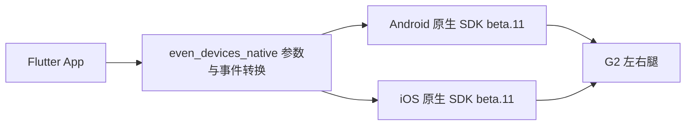

# even_devices_native

直接调用 Android Kotlin / iOS Swift 原生 SDK 的独立 Flutter 薄插件，接入 G2 的扫描、企业验签、双腿业务 AUTH、时间同步、EvenHub 和断连。

[Even Hub 官方文档：Get Started / Overview](https://hub.evenrealities.com/docs/get-started/overview)



License JSON 的解析、全量校验、按目标 SN 精确匹配、8403 编码、双腿连接及 READY 判定都在原生 SDK 内。Dart 仅原样传递字符串、端点信息并转换事件。

## 接入

本地路径依赖：

```yaml
dependencies:
  even_devices_native:
    path: ../even_devices_native
```

Git 依赖须固定审核后的 commit，并使用有仓库读取权限的 GitHub 账号：

```yaml
dependencies:
  even_devices_native:
    git:
      url: git@github.com:even-realities/even_devices_native.git
      ref: <audited-commit-sha>
```

Android AAR、Maven 元数据和 iOS XCFramework 已放在包内，无需访问内部 Maven/SPM 服务。宿主仍需能解析原生 SDK 已固定的 Gson、coroutines 和 Flutter 构建依赖。来源及校验值见 [PROVENANCE.md](PROVENANCE.md)。本包采用 [Apache 2.0](LICENSE)，第三方许可见 [THIRD_PARTY_NOTICES.md](THIRD_PARTY_NOTICES.md)。

## 初始化和连接

```dart
import 'package:even_devices_native/even_devices_native.dart';
import 'package:flutter/services.dart';

final sdk = EvenDevicesNative.instance;
final subscription = sdk.events.listen((event) {
  if (event.type == 'discovery') {
    // 按 event.sn 展示 event.devices；iOS 左右腿可能分别到达。
  }
  if (event.type == 'g2' && event.phase == 'ready' && event.side == null) {
    // 原生确认两腿完成企业验签和业务 AUTH 后才允许业务命令。
  }
  if (event.type == 'timeSync') {
    // success 是本次时间同步的原生结果。
  }
});

if (!await sdk.requestBluetoothPermissions()) {
  throw StateError('Bluetooth permission denied');
}
await sdk.initialize(
  namespace: accountId,
  licenseJson: await rootBundle.loadString('assets/even_license.json'),
);
await sdk.scan();
// 收集同一 SN 的两侧 discovery 事件后，使用原生返回的地址和名称。
await sdk.connectG2(sn: sn, left: leftEndpoint, right: rightEndpoint);
// 收到整机 ready 之后：await sdk.syncG2Time();
```

将 License JSON 声明为宿主资源。签名平台导出的 `format/app_id/licenses[]` 多 SN 格式和旧 `schema_version/app_id/proofs` 格式均由原生解析。保留 `app_id` 原值；没有目标 SN 时原生拒绝连接，不回退到其他 SN。不要把平台账号或私钥打包进 App。

Android 必须提交扫描所得的左右腿地址及名称。iOS 可以提供一对绑定 UUID，或省略两个端点由原生从当前扫描缓存查找；单边 UUID 会被拒绝。

更新授权与退出：

```dart
await sdk.updateLicenses(newLicenseJson); // 原生校验整个集合后替换。
await sdk.stopScan();
await sdk.disconnectG2();
await sdk.reset(); // 退出或切换账号时退役原生 owner 和待完成回调。
await subscription.cancel();
```

## EvenHub 文字页

等原生整机 `ready` 后提交文字：

```dart
await sdk.openEvenHubTextPage(text: 'Hello EvenHub\nNative SDK demo');
// type=evenHub, phase=active 才表示眼镜确认创建成功。
// phase=heartbeat 表示眼镜确认本次续期；phase=input 携带 event。
await sdk.closeEvenHub();
```

原生 SDK 校验非空且不超过 64 字节的 UTF-8 文字，创建一个可接收点击的文字容器。5 秒心跳、3 秒应答等待、关闭、断连和迟到回调处理均由 Kotlin / Swift 完成。Flutter 不发送协议包或调度心跳。`busy` 拒绝会保留当前页面；关闭时停止续期，等待正在进行的 CREATE/心跳收口后发送关闭。`closed`、`failed` 或系统退出后不再续期。

上面的便利接口用于短文字示例。完整的应用指令使用同一个原生页面 owner：

```dart
await sdk.executeEvenHubCommand(EvenHubCommand.createPage, parameters: {
  'textObjects': [
    {
      'containerId': 1,
      'containerName': 'message',
      'width': 528,
      'height': 240,
      'xPosition': 24,
      'yPosition': 24,
      'isEventCapture': true,
      'content': 'Hello EvenHub',
    }
  ],
});
await sdk.executeEvenHubCommand(EvenHubCommand.updateText, parameters: {
  'containerId': 1,
  'containerName': 'message',
  'content': 'Updated by native SDK',
});
await sdk.executeEvenHubCommand(EvenHubCommand.shutdownPage);
```

| 指令 | 原生职责 |
| --- | --- |
| `createPage` / `rebuildPage` | 校验文字、列表、图片容器和自定义菜单，编码并等待结果；创建后自动续期 |
| `updateText` | 校验当前文字容器身份、编码更新并匹配应答 |
| `updateImage` | 接收整幅固件格式 `data` 字节，分成 4096 字节图片块，再按实际 ATT 写入长度分包；逐块匹配应答 |
| `shutdownPage` / `heartbeat` | 管理页面租约、单飞、超时和关闭顺序；调用方无需定时发送心跳 |
| `audioControl` / `imuControl` | 校验目标状态、编码命令并核对实际响应状态 |
| `menuStartupFailed` / `menuSubitemResponse` | 编码应用回执，经原生传输接纳后完成；固件没有对应 ACK，不能当成设备确认 |

参数约束、响应分支及全部 10 条指令见共享契约 [evenhub_commands.json](docs/evenhub_commands.json)。`sessionId`、容器总数、图片 session/分块信息、心跳计数、magic 和 sync 均由原生生成，不接收宿主传入。原生解析文字、列表、系统、IMU 和菜单事件，通过统一事件流返回语义字段。Flutter 中没有 EvenHub protobuf 编码、分包、应答状态机或心跳定时器。

整机 READY 后，即使尚未创建页面，原生也会转发菜单启动和页面进入/退出超时通知，并允许 `menuStartupFailed` 发送启动失败回执。该路径只属于当前连接，不会创建页面或开启心跳。

`shutdownPage(exitMode: 1)` 请求眼镜显示退出确认，ACK 只确认该请求，结果携带 `awaitingExit: true`；原生继续续期，直到收到匹配当前 widget/session 的实际退出事件。默认 `exitMode: 0` 和短文字便利接口直接关闭。页面被占用期间，原生拒绝时间同步，避免它与心跳争用传输。

`updateImage` 的 `data` 必须已经是与 `compressMode` 对应的固件图片字节；本版未提供 PNG/BMP 解码、像素转换或 LZ4 压缩工具。完整指令集通过自动化测试，仍需在正式固件上逐项验收。

## 事件与生命周期

| 类型 | 含义 |
| --- | --- |
| `discovery` | 原生广播身份，包含 SN 和已发现端点，不表示已授权 |
| `g2` | 原生连接及授权结果；只有整机 `ready` 可以表示 READY |
| `timeSync` | 原生时间同步结果，包含适用的 operation/generation |
| `evenHub` | 原生页面生命周期、心跳确认和已解码的交互事件；提交请求不等于显示成功 |
| `transport` / `business` | 平台诊断或已收到的数据，不作为整机 READY |

事件保留 `namespace`、SN、side、endpointId 和适用的代际字段。Android 当前公开整机 generation；缺失的 session/attempt 字段保持 null，调用方不得伪造。各平台诊断详情可以不同，未知类型或 phase 仍保留供观察。

连接、时间同步及短文字便利接口的 Future 完成表示请求已提交，其结果从事件流观察。`executeEvenHubCommand` 等待原生命令完成，两个应用回执指令按上表的传输接纳语义完成。请先监听事件再初始化；原生流不补发历史 READY。全局使用一个 `EvenDevicesNative.instance`，同一进程只允许一个 Flutter engine 持有此插件的原生 owner。取消订阅仅移除监听，不断开连接；宿主退出时显式 `reset()`。`namespace` 用于此次桥接 owner 和事件标识，不承诺跨进程自动恢复账号缓存。

## 平台要求

- 仓库验证基线：Flutter 3.32.0 / Dart 3.8，见 `.fvmrc`。
- Android：minSdk 21、compileSdk 36、Java/Kotlin 17、NDK 27.0.12077973。插件与示例使用 AGP 8.7.3；[该系列官方支持的最高 API 为 35](https://developer.android.com/build/releases/agp-8-7-0-release-notes)，API 36 的发布工具链仍需升级验证，见仓库原生迁移状态。
- Android Manifest 已声明蓝牙权限；`requestBluetoothPermissions()` 使用附着的 Activity 请求权限。Android 11 及以前扫描还需要系统定位服务开启。此方法不会打开系统蓝牙。
- iOS：最低 15.0；宿主 `Info.plist` 必须添加 `NSBluetoothAlwaysUsageDescription`。权限由初始化触发的 CoreBluetooth 系统流程处理，iOS 的 `requestBluetoothPermissions()` 返回值仅表示可以继续系统流程，不表示已获系统授权。

```xml
<key>NSBluetoothAlwaysUsageDescription</key>
<string>用于扫描和连接 Even G2 眼镜</string>
```

## 手动示例与验证

[example](example/README.md) 启动后不会自动初始化或连接。设置中粘贴完整 License JSON 并初始化；「扫描」「设备」「EvenHub」「日志」分别展示扫描候选、整机与双腿详情、文字页交互及独立日志看板。两腿出现前连接按钮不可用，业务按钮等待原生整机 READY。

在本包目录执行：

```bash
fvm flutter pub get
fvm flutter analyze
fvm flutter test
./tool/verify_artifacts.sh
cd example
fvm flutter test
fvm flutter build apk --debug
fvm flutter build ios --no-codesign --debug
```

Flutter 3.32 与 Xcode 27 的通用模拟器构建存在已知多架构 `lipo` 校验问题，见 [Flutter 官方修复](https://github.com/flutter/flutter/pull/188625)。本工作站用 Xcode 的 `ARCHS=arm64 ONLY_ACTIVE_ARCH=YES` 构建并运行模拟器 XCTest；没有修改全局 Flutter SDK。复现命令见 [示例说明](example/README.md)。

当前版本重新构建 standalone beta.11 AAR / XCFramework，提供原生 EvenHub 指令集和文字页便利接口，并修复心跳计数回显及接收尾部填充兼容问题。心跳确认次数是原生本地指标，ACK 的 Cnt 不参与请求关联。自动化验证包含协议向量、原生会话及超时测试、Flutter 桥接和示例状态测试；详细结果见 [心跳修复记录](docs/VALIDATION.md#evenhub)及[指令迁移记录](docs/VALIDATION.md#evenhub)。这些检查不代替真实眼镜验收。beta.9 仅在原生心跳 ACK 解析中增加对现场固件回填 Cmd12 的兼容，标准 Cmd13 和其余校验保留；WK iPhone 15 的用户真机反馈为 37 次心跳确认；连续 ACK 日志有采集缺口，关闭停止续期和 Android 真机仍待验。

构建使用 Flutter 3.32.0、JDK 21、Gradle 8.12、AGP 8.7.3 和 Xcode 27。Android API 36 的正式工具链支持及 G2 真机双腿验收仍属于发布前待完成项。

## 当前边界与迁移

本包直接链接原生 AAR / XCFramework。宿主接入时替换依赖和 import，并按原生事件接线；移除旧 `even_devices_sdk` / BLE 插件依赖后再接入本包。Android standalone AAR 与旧传输有重叠类，不能同时打入同一个 App。

本次不交付 R1，也尚未接入通知、OTA、完整业务队列、后台自动恢复或异步 license provider；EvenHub 图片预处理工具仍未迁移。这些能力不能以旧 Flutter 业务实现补入本包。详见仓库 [迁移状态](docs/SCOPE.md)。构建与自动化测试不能代替此独立插件在 Android/iOS 上的真实 G2 双腿验收；该验收仍待执行。

当前 beta.11 修复已由 iOS 现场日志证实的 TimeSync 请求 magic 超出固件回填范围问题；Android/iOS 原生分配统一为 1–255，应答仍精确匹配。修复后真机结果待用户触发，见[时间同步记录](docs/VALIDATION.md#timesync)。
